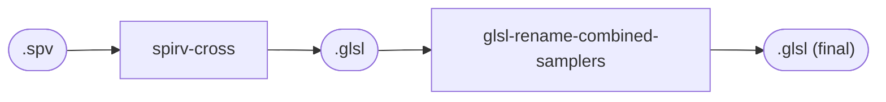
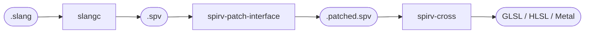

# Shader Compilation

Pomdog compiles Slang shaders to SPIR-V, then uses spirv-cross to produce the formats required by each graphics backend.

For an overview of the full asset pipeline, see [Asset Pipeline and Runtime](asset-pipeline-and-runtime.md).

## Source Language: Slang

All shaders are written in [Slang](https://github.com/shader-slang/slang) (`.slang` files). Slang is a shader language with module and generics support that compiles to SPIR-V as an intermediate representation. Using Slang as the single source language eliminates the need to maintain separate GLSL, HLSL, and Metal shaders.

Source files live in `assets/shaders/` for engine-level shaders and `examples/<app>/assets/shaders/` for per-application shaders.

## Build Recipe: `shaderbuild.toml`

Each shader directory contains a `shaderbuild.toml` that declares compilation units and link groups:

```toml
[[compile_vs]]
name = "basic_effect_vs"
source = "basic_effect.slang"
entrypoint = "basic_effect_vs"

[[compile_ps]]
name = "basic_effect_ps"
source = "basic_effect.slang"
entrypoint = "basic_effect_ps"
vsout = "basic_effect_vs"

[[link]]
name = "basic_effect"
vs = "basic_effect_vs"
ps = "basic_effect_ps"
```

- `[[compile_vs]]` and `[[compile_ps]]` tables encode the shader stage directly in the table name.
- The optional `vsout` field on `[[compile_ps]]` entries tells the pipeline to run `spirv-patch-interface` to restore any VS outputs eliminated by slangc's dead-code elimination (see [Dead-Code Elimination of Varyings](#dead-code-elimination-of-varyings)).

## Build Toolchain

The tool `shader-ninja-gen` reads `shaderbuild.toml` and generates a [Ninja](https://ninja-build.org/) build file (`build.ninja`) that compiles and cross-compiles shaders for every target backend.

| Tool | Role |
|------|------|
| `slangc` | Compile `.slang` → SPIR-V |
| `spirv-cross` | Transpile SPIR-V → GLSL / HLSL / Metal |
| `spirv-shader-reflect` | Extract reflection metadata (UBO names, binding slots) from SPIR-V |
| `spirv-link-validate` | Statically verify VS/PS interface (varying) consistency |
| `spirv-entry-point-validate` | Verify that each SPIR-V module declares exactly one entry point of its stage |
| `spirv-rename-blocks` | Strip `_std140` suffix from UBO type names in SPIR-V |
| `spirv-patch-interface` | Restore PS input variables removed by slangc dead-code elimination |
| `spirv-strip-debug` | Strip debug instructions from Vulkan SPIR-V output |
| `glsl-rename-combined-samplers` | Rewrite spirv-cross combined sampler names back to original texture names |
| `ninja` | Execute the generated build file |

## Multi-Backend Transpilation

| Target | Format | Tool |
|--------|--------|------|
| Vulkan | SPIR-V | `slangc` (native output) |
| OpenGL Desktop | GLSL 4.10 | `spirv-cross` |
| WebGL / Emscripten | GLSL ES 3.00 | `spirv-cross` |
| Metal | Metal library (`.metallib`) | `spirv-cross` → MSL 2.1 → `xcrun metal` and `xcrun metallib` |
| Direct3D 11 | DXBC | `spirv-cross` → HLSL SM4.0 → `fxc.exe` |
| Direct3D 12 | DXIL | `spirv-cross` → HLSL SM6.0 → `dxc.exe` |

The spirv-cross flags used for each target:

```sh
# Desktop GLSL (OpenGL 4.1)
spirv-cross --no-es --version 410 --remove-unused-variables --no-420pack-extension --relax-nan-checks

# ES 300 (WebGL 2 / Emscripten)
spirv-cross --es --version 300 --remove-unused-variables --relax-nan-checks

# Metal
spirv-cross --msl --msl-version 20100 --msl-decoration-binding --relax-nan-checks

# HLSL (Direct3D 11)
spirv-cross --hlsl --shader-model 40 --relax-nan-checks

# HLSL (Direct3D 12)
spirv-cross --hlsl --shader-model 60 --relax-nan-checks
```

> **Note:** Desktop GLSL uses `--version 410`, not `--version 330`. GLSL 3.30 does not support `layout(location)` on varyings, requiring name-based matching which is fragile.

The generated Ninja file is then executed by the bundled `ninja` binary (`build/tools/ninja`).

### NaN in `min`, `max`, and `clamp`

`slangc` emits `min`, `max`, and `clamp` as the SPIR-V instructions that return
the other operand when one is NaN, as HLSL defines them. Without
`--relax-nan-checks`, spirv-cross keeps that behavior by wrapping each call in
`isnan()` checks in GLSL and by emitting `precise::min` and `precise::max` in
MSL, which costs instructions in every shader that compares values. The
pipeline passes `--relax-nan-checks` so that these calls become the plain
functions of each target, and comparisons skip their NaN checks too. A shader
whose result depends on how NaN compares must check `isnan()` itself.

## Metal Libraries

The Metal backend loads only precompiled Metal libraries (`.metallib`) and does not compile MSL source at runtime. The pipeline transpiles each shader to MSL with spirv-cross, compiles the MSL with `xcrun metal`, and links the result into one `.metallib` per shader with `xcrun metallib`.

### Building Metal Libraries on macOS

The pipeline compiles each MSL file with `xcrun metal -std=macos-metal2.1 -mmacosx-version-min=13.0`. The flags match the MSL version that spirv-cross emits and the minimum macOS version of the engine. The pipeline runs the Metal compiler through `xcrun`, which comes with Xcode, so only an asset build on macOS produces `.metallib` files and the macOS archive, as only an asset build on Windows produces DXBC and DXIL.

### Resource Slots and `--msl-decoration-binding`

The engine sets buffers, textures, and samplers by slot (`setConstantBuffer(i)`, `setTexture(i)`, and `setSamplerState(i)`), and the Metal backend passes each slot to Metal as the index of `[[buffer(i)]]`, `[[texture(i)]]`, or `[[sampler(i)]]`. spirv-cross writes these indices into the MSL source, and `--msl-decoration-binding` takes them from the SPIR-V binding numbers, as HLSL registers do. Without the flag, spirv-cross numbers only the resources that a shader uses, so a binding that the shader does not use shifts the indices of the others. For example, if a pixel shader uses only the constant buffer at `binding(1, 0)`, spirv-cross without the flag numbers it `[[buffer(0)]]`. The shader then reads the constant buffer that the engine sets at slot 0 and computes with wrong values, which can draw the whole screen black.

### Function Lookup Without an Entry Point Name

The OpenGL and WebGL backends need shader reflection data to bind slots. The GLSL that the pipeline emits (GLSL 4.10 without the 420pack extension, and GLSL ES 3.00) cannot declare binding numbers, so the pipeline writes a FlatBuffers `.reflect` file for each shader offline, and the backend loads it with the GLSL at runtime to map each uniform block and texture name to its slot (see [Shader Reflection](#shader-reflection)). The Metal backend needs no reflection data, because the MSL source already holds the slots, so it loads only the `.metallib`.

A Metal library can hold several functions, so a Metal application usually names the entry point function when it creates a shader (`newFunctionWithName:`). The Metal backend of Pomdog instead assumes that each `.metallib` holds exactly one function, takes that function without its name, and returns an error if the library holds any other number of functions. The caller of `loadShaderAutomagically()` therefore passes no entry point, as with the other backends. If it passed one, only the Metal backend would use it, so a wrong name would go unnoticed until the shader loaded on Metal. To guarantee the assumption, the asset build checks the number of entry points offline (see [Entry Point Validation](#entry-point-validation)).

## Entry Point Validation

Every shipped shader file holds exactly one entry point, and no backend needs its name at runtime: GLSL and Vulkan SPIR-V name it `main`, Direct3D compiles it offline, and Metal takes the only function of the `.metallib`. To keep this true, the pipeline runs `spirv-entry-point-validate` on the SPIR-V of every shader before any backend uses it. The tool fails the asset build unless the module declares exactly one `OpEntryPoint` and that entry point runs in the stage of the recipe (`compile_vs` or `compile_ps`). Every transpiled output depends on its stamp, so an invalid shader produces no output for any backend.

`entrypoint` in `shaderbuild.toml` only selects the function that slangc compiles. Its value need not match `name`.

## SPIR-V Post-Processing

Before transpilation, the pipeline applies several SPIR-V rewriting passes:

1. **`spirv-rename-blocks`**: Strips the `_std140` suffix that slangc appends to UBO type names (e.g. `SpriteBatchConstants_std140` → `SpriteBatchConstants`). This ensures constant buffer names in transpiled code match the C++ engine's expectations.
2. **`spirv-patch-interface`**: For pixel shaders with a `vsout` reference, restores VS output variables that slangc eliminated via dead-code removal. This prevents semantic gaps (e.g. missing `TEXCOORD1`) in HLSL output.
3. **`spirv-strip-debug`**: Strips debug instructions (`OpName`, `OpSource`, `OpLine`, etc.) and `SPV_KHR_non_semantic_info` metadata. Applied only to the Vulkan SPIR-V output path, after all spirv-cross transpilations are complete.

## GLSL Combined Image-Sampler Renaming

When `spirv-cross` transpiles SPIR-V to GLSL, it may produce **combined image-sampler** identifiers that merge the texture and sampler names into a single prefixed name:

```glsl
// spirv-cross output — combined name
uniform sampler2D SPIRV_Cross_CombinedDiffuseTextureTextureSampler;
```

The pomdog engine's OpenGL backend resolves sampler bind slots by computing xxHash-32 of the **original** texture name (e.g. `DiffuseTexture`). Because `SPIRV_Cross_CombinedDiffuseTextureTextureSampler` does not match the original name, the slot lookup fails at runtime.

The `glsl-rename-combined-samplers` tool post-processes GLSL output to rewrite combined names back to the original texture name:

```glsl
// After glsl-rename-combined-samplers
uniform sampler2D DiffuseTexture;
```

The tool runs after spirv-cross in the Ninja pipeline:



`spirv-shader-reflect` extracts texture bindings from `OpDecorate` instructions for `separate_images` (rather than combined image-samplers), ensuring the reflect data contains the original texture name and its binding index.

> **Note:** This issue only affects the OpenGL / WebGL backends. HLSL, Metal, and Vulkan do not depend on GLSL uniform names.

## Shader Reflection

After compilation, `spirv-shader-reflect` extracts binding metadata from SPIR-V bytecode and writes `.reflect` files. These files use a FlatBuffers schema (`schemas/shader_reflect.fbs`) to record constant-buffer and sampler slot assignments:

```flatbuffers
table ConstantBufferSlot {
    name : uint32(key);   // xxHash-32 of the UBO name
    slot : uint8;         // SPIR-V binding index
}

table SamplerSlot {
    name : uint32(key);   // xxHash-32 of the texture/sampler name
    slot : uint8;         // SPIR-V binding index
}

table ShaderReflect {
    cbuffers : [ConstantBufferSlot];
    samplers : [SamplerSlot];
}
```

A debug variant (`shader_reflect_debug.fbs`) stores human-readable names for development diagnostics.

## Link Validation

The `-link-validate` flag on `shader-ninja-gen` runs `spirv-link-validate`, which checks that vertex shader outputs match pixel shader inputs when a `[[link]]` group is defined. This catches interface mismatches at build time. For each PS input it verifies that a VS output exists at the same location, that the types match, and that the variable **names** match (see [Varying Names Must Match Between VS and PS](#varying-names-must-match-between-vs-and-ps)).

When a warning such as `"VS output 'BlendFactor' (float4) at location 1 is not consumed by PS"` appears, it indicates dead-code elimination has removed a varying. See [Dead-Code Elimination of Varyings](#dead-code-elimination-of-varyings).

## Slang Pitfalls and Workarounds

### Row-Major vs Column-Major Matrix Constructors

GLSL and Slang interpret matrix constructor arguments differently:

| Language | `mat3(v0, v1, v2)` interpretation |
|----------|-----------------------------------|
| **GLSL** | `v0, v1, v2` are **column vectors** (column-major) |
| **Slang/HLSL** | `v0, v1, v2` are **row vectors** (row-major) |

Transpose matrix constructor arguments when converting GLSL shaders to Slang. If an HLSL version exists, compare against it; HLSL and Slang share the same row-major convention.

### Varyings Must Use Flat Parameters, Not Struct Returns

Returning VS outputs as a struct causes spirv-cross to generate mismatched varying names between VS and PS:

| Stage | Generated varying name |
|---|---|
| VS | `entryPointParam_main.Color` |
| PS | `input.Color` |

GLSL ES 3.00 (WebGL 2) matches varyings by **name**, so a mismatch breaks the VS-PS link.

**Solution**: Use `out` parameters instead of struct returns:

```slang
[shader("vertex")]
float4 main(
    VSInput input,
    [[vk::location(0)]] out float4 Color : COLOR0,
    [[vk::location(1)]] out float2 TextureCoord : TEXCOORD0
) : SV_Position
```

### Varying Names Must Match Between VS and PS

Even with flat `out` parameters, the VS output and PS input at the same location must use the **same variable name**. Vulkan, HLSL, and desktop GLSL 4.10 link by location or semantic, so a name difference goes unnoticed there. GLSL ES 3.00 (WebGL 2) links varyings by name, so a mismatch fails at runtime:

```
FRAGMENT varying Color does not match any VERTEX varying
```

For example, a VS that declares `out float4 GlyphColor : COLOR0` while its PS declares `float4 Color : COLOR0` shares the same location and semantic but not the same name, so the WebGL program fails to link even though every other backend works. Name the parameter identically in both stages (`Color` in this case).

`spirv-link-validate` enforces this: it reports `varying name mismatch at location N` as a build error, so the inconsistency is caught offline rather than at runtime in the browser.

### ConstantBuffer and Sampler Binding Collisions

When a shader uses both `ConstantBuffer` and `Sampler2D`, giving both `[[vk::binding(0)]]` produces a Slang warning. Separate them by descriptor set:

```slang
[[vk::binding(0, 0)]]  // binding=0, set=0
ConstantBuffer<MyConstants> cb;

[[vk::binding(0, 1)]]  // binding=0, set=1
Sampler2D myTexture;
```

spirv-cross maps these correctly to each backend's namespace (e.g. HLSL `register(b0)` / `register(t0)`, Metal `buffer(0)` / `texture(0)`).

### Textures Must Use Combined `Sampler2D`

Declare each texture as a combined `Sampler2D`, not as a separate `Texture2D` and `SamplerState`. The engine sets a texture and its sampler at the same slot (`setTexture(i)` and `setSamplerState(i)`), because the OpenGL and WebGL backends tie a sampler to its texture. GLSL has only combined sampler types such as `sampler2D`, and OpenGL binds a sampler object to a texture unit (`glBindSampler()`), so a texture and its sampler share one texture unit. The other backends follow the same model. For example, a `Sampler2D` at `binding(0, 1)` becomes `[[texture(0)]]` and `[[sampler(0)]]` in MSL, `register(t0)` and `register(s0)` in HLSL, and a combined image sampler at binding 0 of set 1 in SPIR-V, which the Vulkan backend expects.

Giving a separate `SamplerState` the binding of its `Texture2D` makes Slang report an explicit binding overlap (warning E39001), so a separate sampler ends up at another binding and therefore at another slot. For example, suppose that a shader declares a `Texture2D` at `binding(0, 1)` and its `SamplerState` at `binding(1, 1)`, while the engine sets both at slot 0. Without `--msl-decoration-binding`, spirv-cross numbers the only sampler `[[sampler(0)]]`, so the shader works by chance. With the flag, the sampler becomes `[[sampler(1)]]`, where the engine sets no sampler, and the Metal validation layer reports a missing sampler binding at index 1 on every draw.

### `_std140` UBO Name Suffix

When slangc compiles to SPIR-V, it appends `_std140` to ConstantBuffer type names (e.g. `SpriteBatchConstants_std140`). The `spirv-rename-blocks` tool strips this suffix so that transpiled code and C++ engine code use matching names.

### `layout(row_major)` in Generated GLSL

Slang treats matrices as row-major by default. The generated GLSL UBO members include `layout(row_major)` qualifiers, and ES 300 output wraps matrix access in `spvWorkaroundRowMajor()` helper functions. This does not affect correctness as long as the CPU-side data matches the expected layout.

### Dead-Code Elimination of Varyings

Slang's dead-code elimination removes PS input variables that are not referenced in the pixel shader body. This creates **gaps** in varying locations between VS and PS, which can cause display corruption on Direct3D 11.

**Example**: If VS outputs `Color` (location 0), `BlendFactor` (location 1), and `TextureCoord` (location 2), but PS does not use `BlendFactor`, slangc removes location 1 from the PS SPIR-V. The resulting HLSL has `TEXCOORD0` and `TEXCOORD2` with no `TEXCOORD1`, causing a semantic gap.

**Solution**: The `spirv-patch-interface` tool compares VS output and PS input interfaces, then injects missing input variables into the PS SPIR-V:



This is controlled by the `vsout` field in `shaderbuild.toml`. The `spirv-link-validate` tool detects these gaps at build time.

> **Note:** The dead-code elimination occurs during IR lowering, so slangc flags such as `-O0` and `-preserve-params` do not prevent it.

## GLSL → Slang Conversion Reference

### Type Mappings

| GLSL | Slang |
|------|-------|
| `vec2` / `vec3` / `vec4` | `float2` / `float3` / `float4` |
| `mat3x3` / `mat4x4` | `float3x3` / `float4x4` |
| `ivec2` | `int2` |
| `sampler2D` | `Sampler2D` |

### Function Mappings

| GLSL | Slang |
|------|-------|
| `texture(tex, uv)` | `tex.Sample(uv)` |
| `mix(a, b, t)` | `lerp(a, b, t)` |
| `v * M` | `mul(v, M)` |
| `M * v` | `mul(M, v)` |

> **Important:** Use `mul()` for matrix-vector multiplication in Slang; `*` does not perform that operation.

### UBO Syntax

```slang
struct SpriteBatchConstants {
    float4x4 ViewProjection;
};

[[vk::binding(0, 0)]]
ConstantBuffer<SpriteBatchConstants> cb;
```

### Texture / Sampler Syntax

```slang
[[vk::binding(0, 1)]]
Sampler2D myTexture;
```

### Entry Points

```slang
[shader("vertex")]
float4 vertexMain(
    VSInput input,
    [[vk::location(0)]] out float4 Color : COLOR0
) : SV_Position
{
    Color = input.Color;
    return mul(float4(input.Position.xy, 0.0, 1.0), cb.ViewProjection);
}

[shader("pixel")]
PSOutput pixelMain(
    [[vk::location(0)]] float4 Color : COLOR0
)
{
    PSOutput output;
    output.FragColor = Color;
    return output;
}
```
